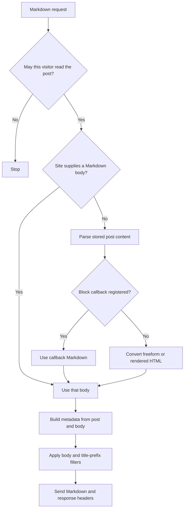

# How the Markdown response is built

This document explains the conversion decisions that matter when a site adds
custom blocks or filters. For the hooks and their return values, see
[Adapt Content for Agents to your site](SITE-SETUP.md).

## Which content becomes Markdown

`Markdown_Converter` reads the post's stored `post_content` and parses its
blocks in order. It does not apply `the_content` to the entire post. The
`content_for_agents_pre_markdown` filter can supply a complete body before
block parsing, for example when a post type stores its own Markdown.

For each parsed block, the converter makes these choices:

1. Freeform content, including Classic Editor HTML between blocks, goes through
   HTML conversion. It has no block name, so a block callback cannot handle it.
2. A registered callback receives the parsed block and post. Its Markdown is
   used directly, then passed to `content_for_agents_block_{block-name}`. Empty
   output omits the block. Neither result goes through HTML conversion.
3. Without a callback, the converter uses built-in handling or renders the
   block and converts its HTML. Dynamic block render callbacks can therefore
   run during a Markdown request.

A parent callback owns the whole block subtree. It must include any children
it wants in the result, and can call `blocks_to_markdown()` for selected child
blocks. When the parent has no callback but a child needs its own strategy,
the converter walks the parent's saved `innerContent` in order. It converts
the parent's HTML fragments and processes each child separately. This keeps a
child callback available without discarding the parent's surrounding content.

If the parent renders only some children on the HTML page, its Markdown
callback should apply the same rule. A child callback cannot determine which
children an unrelated parent renderer chose to hide.

## What the HTML path does

The HTML path prepares registered shortcodes and WordPress typography before
conversion. An unregistered shortcode with a recognizable URL becomes a link;
otherwise it remains literal. Ordinary blocks use `render_block()`, while a
Shortcode block starts with its shortcode text. Core embeds use a readable
WordPress preview when available, or retain their URL.

The converter targets CommonMark, with GFM tables and strikethrough. It keeps
headings, lists, links, images, quotes, captions, and code readable. Audio,
video, and iframe sources generally become links instead of interactive
players. It uses inline HTML when Markdown cannot preserve the original
structure. The implementation draws on the deferred block model in
[html-to-md](https://github.com/dmsnell/html-to-md).

## How the document is assembled

The endpoint first checks WordPress and plugin access rules. It then gets the
filtered post title and converts the body. Frontmatter is built from the post
and that body. Only after frontmatter is built does
`content_for_agents_after_markdown` change the body. The default post-title
heading then passes through `content_for_agents_markdown_prefix`, and the
endpoint joins frontmatter, prefix, and body. A description derived from the
body therefore reflects the body **before** the after-Markdown filter. An
integration that needs a different description should use
`content_for_agents_frontmatter`.

Invalid callback output, a `WP_Error`, or an exception stops conversion. The
endpoint returns a generic HTTP 500 instead of serving or caching a partial
document. Direct `post_to_markdown()` callers receive the body or a
`WP_Error`; they do not get frontmatter or the after-Markdown filter.

The endpoint sends the canonical HTML link, token estimate, Content-Signal,
and `noindex` response headers with the document. Eligible public responses
may be served from VIP's edge cache. Private and visitor-specific responses
need private, no-store headers; see the [access and cache rules](SITE-SETUP.md#access-and-cache-rules).

## Why the post context is reset

WordPress and site callbacks may read global `$post` even when they receive a
post argument. `Post_Context` temporarily sets the requested post and restores
the caller's globals afterward. The title, body conversion, and response
assembly each use a separate context. This prevents a title filter that
changes global `$post` from making later metadata or excerpts use another
post. Direct converter calls also get the correct context.

For the sampled usage counters, see [Analytics on WordPress VIP](../README.md#analytics-on-wordpress-vip).
